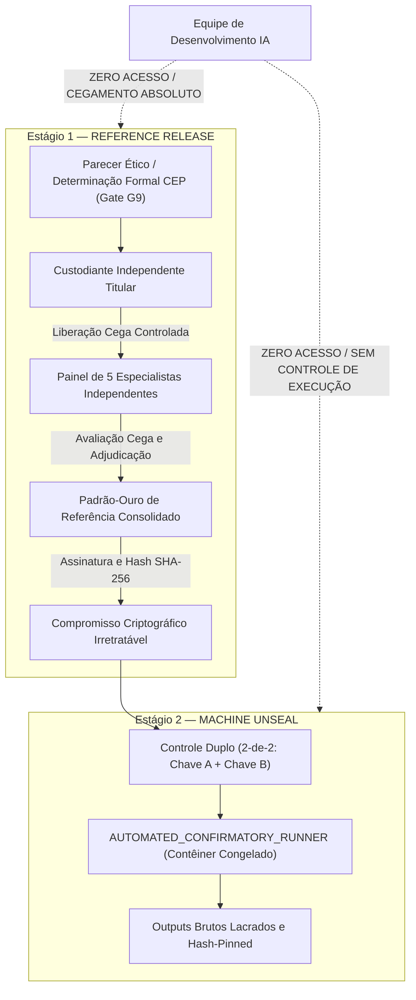

# Estatuto de Custódia Independente em Duas Etapas — Datasets C1 e C2 (Gate G10)

**Documento**: `G10_CUSTODY_CHARTER.md`  
**Versão**: `1.2` (Revisado per CG-20261010-012 e CG-20261010-013)  
**Data**: 12 de Outubro de 2026  
**Finalidade**: Estabelecer formalmente a arquitetura de custódia cega em dois estágios, a segregação de funções, os protocolos criptográficos de controle duplo, a execução exclusivamente automatizada e as salvaguardas de integridade para os datasets confirmatórios C1 e C2.

---

## 1. Princípio Fundamental de Custódia Cega em Duas Etapas (Two-Stage Custody Architecture)

A exposição dos conjuntos confirmatórios **Dataset C1** (Eficácia em Diversidade Não Observada) e **Dataset C2** (Segurança e Abstenção Sob Condições Adversariais) é governada estritamente pelo **Modelo de Custódia em Duas Etapas**:

### 1.1. Estágio 1 — Liberação de Referência (*Reference Release*)
1. Ocorre exclusivamente após a determinação ética formal do CEP competente e cumprimento de todos os pré-requisitos de governança (Gate G9).
2. O Custodiante Independente Titular libera **unicamente os enunciados descritivos dos cenários** diretamente aos 5 especialistas credenciados.
3. **Cegamento Absoluto dos Desenvolvedores**: A equipe técnica do HelpUS permanece **100% cega**, sem qualquer acesso aos enunciados ou às deliberações em andamento.
4. **Travamento Criptográfico do Padrão-Ouro**: As notas individuais e o vetor consensual resultante da adjudicação são consolidados e travados por hash SHA-256 irretratável (`sha256(reference_gold_standard)`), assinado pelos custodiantes antes de qualquer etapa subsequente.

### 1.2. Estágio 2 — Deslacre de Máquina (*Machine Unseal*)
1. Autorizado apenas após o travamento público do hash do padrão-ouro humano.
2. A execução é conduzida sem intervenção humana de desenvolvedores, utilizando o papel **`AUTOMATED_CONFIRMATORY_RUNNER`**: um runtime contêinerizado, previamente congelado e verificado por hash, executado em ambiente *clean-room* e *air-gapped*.
3. Os resultados brutos da inferência são imediatamente gravados, gerando digests SHA-256 e lacres digitais antes de qualquer apuração estatística comparativa.
4. **Vedação Absoluta de Visualização Prévia**: É **expressa e terminantemente vedado** ao Pesquisador Responsável, aos Custodiantes e à Equipe de Desenvolvimento visualizar, inspecionar ou ter acesso preliminar às saídas brutas do runner até que o processo automatizado de lacre criptográfico e geração dos hashes SHA-256 tenha sido completamente finalizado e averbado.

---

## 2. Governança Criptográfica, Controle Duplo e Papéis de Custódia de Chaves

* **Esquema de Chaves Dual-Control ($2\text{-of-}2$)**:
  - **Componente de Chave A**: Mantido sob custódia criptográfica exclusiva do **Custodiante Independente Titular** (Auditor Externo A).
  - **Componente de Chave B**: Mantido sob custódia criptográfica exclusiva do **Co-Custodiante Independente Suplente** (Auditor Externo B).
  - **Papel do CEP**: O CEP competente possui prerrogativa regulatória ética e de homologação de conformidade institucional, mas **não detém custódia operacional de chaves criptográficas técnicas**.
  - **Papel do Pesquisador Responsável (Wagner Santos)**: Atua como autoridade requerente metodológica, co-assinando a autorização de abertura após homologação do CEP, sem posse unilateral de componentes de chave de decifragem.
* **Log Imutável com Ancoragem Externa (*Anti-Truncation Ledger*)**:
  - Todas as operações operacionais são registradas em log *append-only* encadeado por hash (`G10_ACCESS_LOG.jsonl`).
  - Reconhecendo que um repositório Git ordinário por si só não é imutável contra reescrita de histórico forçada, a integridade do protocolo apoia-se estritamente em **checkpoints externamente ancorados**: carimbos de tempo criptográficos RFC 3161 emitidos por Autoridade de Carimbo do Tempo (ACT), tags GPG assinadas distribuídas e registros em ledger WORM (*Write Once, Read Many*) independente.
* **Isolamento de Runtime e Higienização de Memória**:
  - O runner automatizado opera sem conectividade externa (*network egress desabilitado em nível de firewall do kernel*).
  - Todo material em texto claro reside em disco volátil cifrado e na memória RAM efêmera. Ao término do processamento, realiza-se **higienização e sobrescrita segura de memória** (*memory wiping / cryptographic zeroization*) seguida de destruição efêmera do contêiner.

---

## 3. Política Pré-Especificada de Falhas: Distinção entre Rerun Proibido e Retry Mecânico

1. **Rerun Científico (VEDAÇÃO ABSOLUTA)**:
   - É **terminantemente vedada** qualquer reexecução após a emissão de outputs interpretáveis pelo modelo, mesmo parciais.
   - Qualquer modificação de código, hiperparâmetros, pesos ou topologias após a abertura de C1/C2 desqualifica sumariamente o experimento confirmatório.
2. **Retry de Infraestrutura (Restrito, Técnico e Auditado)**:
   - Permitido exclusivamente em falhas mecânicas ou de sistema operacional ocorridas **antes da emissão de qualquer saída analítica** (ex.: falha de energia, corrupção de hardware na carga do contêiner).
   - Exige laudo técnico circunstanciado emitido conjuntamente pelo Custodiante Independente Titular e pelo Co-Custodiante Suplente, atestando que nenhuma informação de saída foi observada ou vazada.

---

## 4. Cláusula de Irreversibilidade e Status de Congelamento

* `SAFE_TO_FREEZE` permanece estritamente **`NO`** durante toda a fase de governança pré-congelamento, até que os Gates G9 (Aprovação Ética Formal) e G10 (Custódia Independente Concluída) sejam plenamente finalizados.
* Qualquer violação da integridade de custódia rebaixa irreversivelmente C1 e C2 a dados exploratórios, demandando um novo conjunto confirmatório independente.
