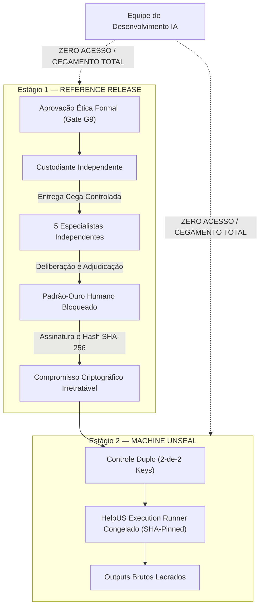

# Estatuto de Custódia Independente em Duas Etapas — Datasets C1 e C2 (Gate G10)

**Documento**: `G10_CUSTODY_CHARTER.md`  
**Versão**: `1.1` (Revisado per CG-20261010-010 e CG-20261010-011)  
**Data**: 12 de Outubro de 2026  
**Finalidade**: Estabelecer formalmente a arquitetura de custódia cega em dois estágios, a segregação de funções, os protocolos criptográficos de controle duplo e as salvaguardas de execução irrepetível para os datasets confirmatórios C1 e C2.  

---

## 1. Princípio Fundamental de Custódia Cega em Duas Etapas (Two-Stage Custody Architecture)

A exposição dos conjuntos confirmatórios **Dataset C1** (Eficácia em Diversidade Não Observada) e **Dataset C2** (Segurança e Abstenção Sob Condições Adversariais) é governada estritamente pelo **Modelo de Custódia em Duas Etapas**:

### 1.1. Estágio 1 — Liberação de Referência (Reference Release)
1. Ocorre exclusivamente após a aprovação formal do protocolo pelo CEP competente (Gate G9).
2. O Custodiante Independente libera os cenários técnicos descritivos diretamente aos 5 especialistas credenciados.
3. **Cegamento da Equipe**: Os desenvolvedores do HelpUS **permanecem 100% cegos** quanto aos cenários e às deliberações.
4. **Travamento Humano**: As respostas individuais e as decisões da sessão de adjudicação são formalmente consolidadas, lacradas e vinculadas a um hash de compromisso criptográfico irretratável (`sha256(reference_gold_standard)`).

### 1.2. Estágio 2 — Deslacre de Máquina (Machine Unseal)
1. Somente após a publicação e travamento do compromisso criptográfico do padrão-ouro humano, autoriza-se o deslacre de máquina.
2. O dataset é decifrado em memória volátil de um ambiente de execução rigorosamente isolado para o runner estático e congelado do HelpUS.
3. Os resultados brutos da execução da IA são imediatamente lacrados antes de qualquer análise comparativa.

---

## 2. Governança Criptográfica e Controle Duplo (Dual-Control Keys)

* **Esquema de Chaves ($m$-of-$n$)**: Regime de controle duplo estrito **2-de-2**:
  - *Componente de Chave A*: Gerado e mantido sob custódia exclusiva do **Custodiante Independente Titular**.
  - *Componente de Chave B*: Gerado e mantido sob custódia exclusiva do **Auditor Externo Suplente / Comitê de Ética**.
  - O pesquisador responsável e a equipe técnica **não possuem componentes de chave de decifragem**.
* **Log Append-Only Hash-Chained**: Todas as operações de custódia, checkpoints e tentativas de acesso são registradas em log append-only com encadeamento de hashes (`G10_ACCESS_LOG.jsonl`), impedindo qualquer retroatividade ou exclusão.
* **Isolamento de Runtime e Filtragem de Rede (Network Egress)**:
  - O runner opera em contêiner ou máquina virtual isolada sem acesso à rede externa (*air-gapped* ou bloqueio total de egress).
  - Material temporário decifrado reside exclusivamente em RAM e é destruído (*shred*) ao término do processo.

---

## 3. Política Pré-Especificada de Falhas: Distinção entre Rerun Proibido e Retry de Infraestrutura

Para preservar a integridade científica sem comprometer a viabilidade operacional em caso de falhas mecânicas:

1. **Rerun Científico (VEDAÇÃO ABSOLUTA)**:
   - É **terminantemente proibido** reexecutar o modelo após a emissão de qualquer score, inferência ou output interpretável, mesmo que parcial.
   - Qualquer ajuste de código, heurística, prompt ou peso após a exposição a C1/C2 anula irreversivelmente o status confirmatório dos datasets.
2. **Retry de Infraestrutura (Restrito e Auditado)**:
   - Permitido **exclusivamente** na ocorrência comprovada de falha de infraestrutura (ex.: queda de energia elétrica, pane de hardware ou falta de memória) ocorrida **antes de qualquer saída ou resultado interpretável ser gerado ou exposto**.
   - O retry exige autorização formal do Custodiante Independente e verificação obrigatória de integridade dos hashes congelados de código, dependências e dados.

---

## 4. Cláusula de Irreversibilidade

Se qualquer intervenção científica no motor HelpUS for considerada necessária após o deslacre de máquina, **os Datasets C1 e C2 perdem permanentemente o seu valor confirmatório**, sendo rebaixados a dados exploratórios e demandando a coleta independente de um novo **Dataset D**.
