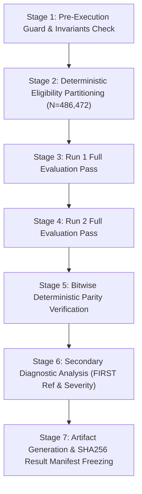

# R6.2 Differential CVSS v4.0 Execution Plan (Corrected Measurement Protocol R2)
## Test Suite: `TEST-SUITE-R6-DIFFERENTIAL-CVSS40-R2`

* **Document Version**: 2.0.0-R2
* **Protocol Version**: R6.2
* **Protocol Deviation Reference**: **`R6-DEV-005`** (`POST_RESULT_CHANGE`)
* **Research Question Linkage**: **`RQ-R6-4`** (*Differential Scorer Concordance*)
* **Execution Status**: `PREREGISTERED_FROZEN_NOT_EXECUTED`
* **Predecessor Experiment**: `TEST-SUITE-R6-DIFFERENTIAL-CVSS40-R1` in [`validation/article/r6_differential_r1/`](file:///d:/AntiG/cvss/validation/article/r6_differential_r1/)
* **Target Populations**:
  * Primary Numeric Endpoint: $D_{\text{numeric}} = 461{,}444$ valid score-producing vectors
  * Secondary Negative Endpoint: $D_{\text{validation}} = 25{,}028$ syntax test cases
  * Total Corpus Records: $D_{\text{total}} = 486{,}472$ ($461{,}444 + 25{,}028 = 486{,}472$)
* **Runner Script**: [`scripts/run_r6_2_differential_experiment.py`](file:///d:/AntiG/cvss/scripts/run_r6_2_differential_experiment.py)

---

## 1. Execution Objectives & Scope

This execution plan operationalizes the preregistered measurement protocol R2 to evaluate differential scoring and validation concordance between the HelpUS primary CVSS v4.0 scorer (Red Hat `cvss` 3.6) and the independent comparator `cvss4py` (commit `9fe705c`).

The plan enforces:
1. Strict decoupling of numeric float score concordance from syntax validation concordance.
2. Ingestion of the frozen corpus eligibility manifest before any scoring or classification logic.
3. Correct attribution of missing-metric test cases via inclusion of `MissingMetric` in the comparator expected validation exception contract.
4. Two independent full passes (Run 1 and Run 2) to guarantee bitwise deterministic repeatability.
5. Secondary diagnostic analysis against official FIRST reference outputs for any numeric mismatch.
6. Zero access to held-out data and zero retuning of scoring arithmetic.

---

## 2. Multi-Stage Execution Workflow

### Stage 1: Pre-Execution Guard & Integrity Verification
1. Pinned Git commits verification:
   * Working repository HEAD: `096e2777e5f938ce70ef6a49c73847da7809415d`
   * Comparator `cvss4py`: `9fe705cdb7d4a222770e0561f046d3e3f061088a`
   * Vector corpus `cvss-resources`: `d766d0c8ab4368b67bf27dd0e411eb481f05fdbb`
2. Deviation log verification:
   * Verify `R6-DEV-005` recorded as `POST_RESULT_CHANGE` in `validation/article/r6_a1_protocol_deviation_log.md`.
3. Historical R1 preservation check:
   * Verify all 5 R1 result files match their registered SHA-256 hashes.
4. Held-out quarantine enforcement:
   * Verify held-out directory is not imported or accessed.

### Stage 2: Eligibility Partitioning & Pre-Filtering
1. Read `validation/article/r6_differential_r2/r6_differential_r2_corpus_eligibility_manifest.json`.
2. Ingest all 486,472 records from the three fixture files:
   * `macro-vectors`: 270 records $\rightarrow$ `VALID_SCORE_VECTOR`
   * `reference-vectors` lines 6..275: 270 records $\rightarrow$ `VALID_SCORE_VECTOR`
   * `reference-vectors` lines 281..25308: 25,028 records $\rightarrow$ `NEGATIVE_VALIDATION_CASE`
   * `reference-vectors` lines 25316..66331: 41,000 records $\rightarrow$ `VALID_SCORE_VECTOR`
   * `base-threat-vectors`: 419,904 records $\rightarrow$ `VALID_SCORE_VECTOR`
3. Validate partition sums:
   $$461{,}444\ (\text{valid}) + 25{,}028\ (\text{negative}) = 486{,}472\ (\text{total})$$

### Stage 3 & 4: Dual Full Passes (Run 1 and Run 2)
1. Execute Run 1 across all 486,472 records sequentially:
   * For records tagged `VALID_SCORE_VECTOR`: evaluate under Primary Endpoint taxonomy (`EXECUTION_ERROR > VALIDITY_DISAGREEMENT > SCORE_MISMATCH > EXACT_SCORE_MATCH`).
   * For records tagged `NEGATIVE_VALIDATION_CASE`: evaluate under Secondary Endpoint taxonomy (`NEGATIVE_EXECUTION_ERROR > NEGATIVE_VALIDITY_DISAGREEMENT > SYNTAX_REJECTION_CONCORDANCE`).
2. Execute Run 2 across all 486,472 records sequentially under identical conditions.

### Stage 5: Deterministic Parity Verification
1. Compare aggregate category counts between Run 1 and Run 2.
2. Compare per-record results bitwise between Run 1 and Run 2.
3. If any discrepancy exists, abort and fail closed.

### Stage 6: Secondary Diagnostic Analysis
1. For every record in `VALID_SCORE_VECTOR` with `SCORE_MISMATCH`:
   * Compare both scores against the official FIRST reference score.
   * Categorize into: `HELPUS_MATCHES_FIRST_REFERENCE_ONLY`, `CVSS4PY_MATCHES_FIRST_REFERENCE_ONLY`, `NEITHER_MATCHES_FIRST_REFERENCE`, or `FIRST_REFERENCE_UNAVAILABLE`.
2. For every valid record with scores from both engines:
   * Derive qualitative severity bands (Section 4.2).
   * Categorize into: `SAME_SEVERITY_BAND`, `SEVERITY_BOUNDARY_CROSSED`, or `NOT_APPLICABLE`.

### Stage 7: Artifact Generation & SHA256 Freezing
Generate in `validation/article/r6_differential_r2/`:
* `r6_differential_r2_results.json`
* `r6_differential_r2_summary.md`
* `r6_differential_r2_mismatch_analysis.md`
* `r6_differential_r2_execution_manifest.json`
* `r6_differential_r2_mismatches.jsonl`
* `SHA256SUMS_RESULTS.txt`

---

## 3. Epistemological and Governance Safeguards

* **No Retuning**: Strictly zero adjustment of rounding logic or tolerance thresholds ($|\Delta| < 0.0001$).
* **Fail-Closed Execution**: Any unrecognized exception immediately halts execution.
* **HITL Compliance**: Results are frozen and presented to the supervisor; no operational deployment without human authorization.
* **Separation of Evidence**: R1 and R2 results remain separate, independently auditable directories.
